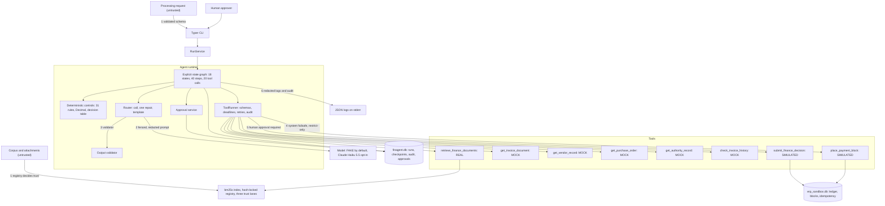

# Architecture

Numbered markers are the six trust boundaries listed below the diagram.

## Trust boundaries

1. **Input and documents.** Requests are schema-validated. Frontmatter confers no trust, and only the hash-locked registry does.
2. **Prompt.** Supplier text is capped, stripped and fenced in one `<data>` block. Untrusted documents appear as metadata only.
3. **Model output.** The validator rejects unknown citations, unbound numbers, forbidden claims, contradictions of the outcome, and omitted exceptions or unknowns.
4. **Block tool.** Only `SYSTEM_FAILSAFE` can call it. It can restrict payment and nothing else.
5. **Decision tool.** Deny by default. It needs an approved human record bound to the run, payload hash and action, plus an idempotency key.
6. **Persistence and logs.** Bank details are stored as HMAC fingerprints. Logs, audit, notes and raw model replies are redacted. Checkpoints hold no case-document text.

## Component and configuration manifest

| Component | Implementation | Configuration | Status |
|---|---|---|---|
| Model | `LLMClient`, `AnthropicLLM`, `FakeLLM` | `config/model.yaml`, `FINAGENT_LLM`, `ANTHROPIC_API_KEY` | Fake by default, real opt-in |
| Agent runtime | Framework-free state graph in `src/finagent/orchestration/` | `spec/graph.yaml` | Real |
| Budgets, timeouts, retries | `ToolRunner` | `config/tools.yaml` | Real |
| Controls | `src/finagent/controls/` | `spec/policy_rules.yaml`, `config/fraud_indicators.yaml` | Real |
| Document store and index | `bm25s` over 15 registered documents | `config/registry.yaml`, `corpus/` | Real, local |
| Persistence | SQLite (WAL) with versioned migrations | `FINAGENT_HOME` | Real, local |
| Finance system | Sandbox ledger and blocks | `spec/submit_permissions.yaml` | Simulated |
| Records | Fixture-backed tools with fault injection | `fixtures/cases/*/meta.json` | Mock |
| Output validation | `src/finagent/llm/validator.py` | `config/forbidden_claims.yaml` | Real |
| API surface | Typer CLI: `ingest`, `run start/get/approve/reject/resume`, `eval`, `eval list` | None | Real |
| Secrets | Environment variables only | `.env.example` | Example only |
| Environment | `uv.lock`, `.python-version`, `Makefile` | None | Local |
